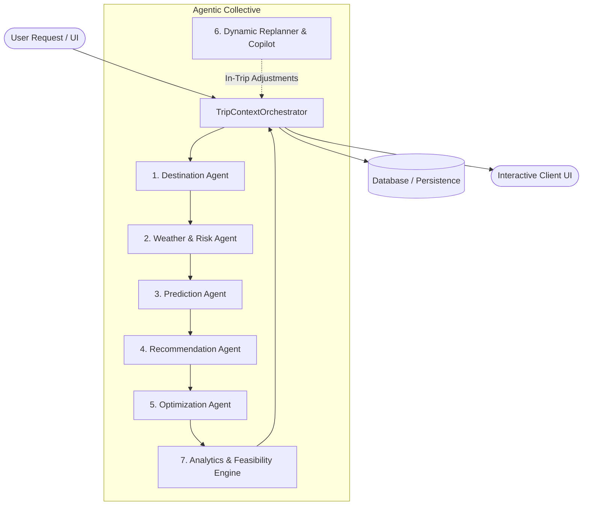

# 7-Agent System Architecture & Orchestration

**Project Title:** TRAVELMATE AI — *An Intelligent and Personalized Travel Planning System Using Hybrid ML & Multi-Objective Optimization*

---

## 1. Architectural Philosophy

TravelMate AI replaces monolithic recommendation pipelines with an asynchronous, modular **7-Agent Architecture**. Each specialized agent encapsulates domain-specific heuristics, machine learning inference, and external APIs while synchronizing state through an immutable `TripContext`.

---

## 2. Specialized Agents Specification

### 1. Destination Discovery Agent (`backend/agents/destination_agent.py`)
- **Role:** Geospatial grounding and candidate place filtering.
- **Inputs:** Destination name/query, travel pace, trip duration.
- **Operations:**
  - Queries local database or Overpass / Nominatim geocoding services.
  - Retrieves attractions with validated latitude, longitude, entry costs, visit duration, and operating time windows $[O_i, C_i]$.
  - Filters out unviable places (e.g., permanently closed or out-of-bounds).
- **Outputs:** Validated list of candidate place entities.

### 2. Weather & Environmental Risk Agent (`backend/agents/weather_agent.py`)
- **Role:** Real-time atmospheric forecasting and outdoor suitability appraisal.
- **Inputs:** Latitude, longitude, start date, number of days.
- **Operations:**
  - Queries the free Open-Meteo Weather API (caching responses with a 6-hour TTL).
  - Evaluates diurnal temperature range, wind speed, and precipitation probability.
  - Classifies each day into `Optimal`, `Good`, `Caution`, or `Severe Alert`.
  - Pinpoints disruption windows (e.g., afternoon thunderstorms).
- **Outputs:** Daily `WeatherForecast` array with outdoor suitability scores.

### 3. Multimodal Prediction Agent (`backend/agents/prediction_agent.py`)
- **Role:** Deep predictive feature extraction across crowd, cost, and disruption risk.
- **Models:**
  - **Crowd Regressor:** LightGBM regressor trained on 15,000 synthetic observations predicting hourly crowd density ($R^2 = 0.950$, MAE = 3.26%).
  - **Cost Regressor:** GradientBoosting regressor estimating attraction entry + transit + refreshment costs ($R^2 = 0.784$, MAE = ₹154.40).
  - **Disruption Classifier:** Multi-class LightGBM classifier categorizing operational risk into `Low`, `Medium`, or `High` (Accuracy = 99.4%, Macro-F1 = 0.9937).
- **Outputs:** Enriched place profiles with diurnal crowd vectors and disruption risk tags.

### 4. Recommendation & Personalization Agent (`backend/agents/recommendation_agent.py`)
- **Role:** Individualized scoring and local explainability.
- **Pipeline:**
  1. **Content-Based Model:** Cosine similarity over TF-IDF vectors of category, tags, and user interest weights.
  2. **Collaborative Filtering:** TruncatedSVD (20 latent factors) with folding-in projection of user seed ratings.
  3. **LightGBM Blender:** Regressor combining content score, collaborative score, popularity, crowd forecast, and price match to predict personalized rating in $[0, 1]$.
  4. **SHAP TreeExplainer:** Computes local feature attributions, rendering the top 3 plain-English reasons: *"Why this place?"*.
- **Outputs:** Ranked candidate attractions with personalization scores and SHAP explainability cards.

### 5. Multi-Objective Optimization Agent (`backend/agents/optimization_agent.py`)
- **Role:** Mathematical itinerary synthesis via Team Orienteering Problem with Time Windows (TOPTW).
- **Algorithm:** NSGA-II with custom domain repair operator.
- **Objectives:**
  1. $f_1 = \max \sum \text{Personalization Score}$
  2. $f_2 = \min \text{Total Estimated Cost (INR)}$
  3. $f_3 = \min \text{Total Travel Time (minutes)}$
  4. $f_4 = \max \text{Category Diversity (Intra-Day Shannon Entropy)}$
  5. $f_5 = \min \text{Average Visited Crowd Density}$
- **Constraints Enforced:**
  - No place visited more than once across all days.
  - Daily active window $\le T_{\text{max}}$ (8.5 hours).
  - Overall budget cap adherence.
  - Arrival within operating hours: $A_{i} + D_{i} \le \text{Close}_i$.
  - Maximum places per day based on pace ($P_{\text{max}} \in \{3, 4, 6\}$).
- **Outputs:** Pareto optimal front of non-dominated solutions with Knee Point identified via TOPSIS / normalized Euclidean distance.

### 6. Dynamic Replanning & Copilot Agent (`backend/agents/copilot_agent.py` & `replanner.py`)
- **Role:** In-trip resilience and interactive conversational assistance.
- **Capabilities:**
  - **Deterministic Rule Router:** Executes 12 backend tools (weather check, crowd lookup, budget breakdown, food suggestions, itinerary swap) without requiring an LLM API key.
  - **LLM Integration:** Seamlessly augments with Google Gemini 1.5 or Groq if an API key is provided.
  - **Dynamic Replanner:** Re-optimizes active itineraries in real time under simulated disruptions (e.g., sudden afternoon rain swapping outdoor boating for indoor palace museums).
- **Outputs:** Natural language recommendations, tool execution metadata, and revised itinerary diffs.

### 7. Analytics & Feasibility Engine (`backend/agents/analytics_agent.py`)
- **Role:** System-wide validation and KPI computation.
- **Feasibility Formula:**
  $$\text{Feasibility} = 0.35 \cdot S_{\text{time}} + 0.30 \cdot S_{\text{budget}} + 0.20 \cdot S_{\text{hours}} + 0.15 \cdot S_{\text{pace}}$$
- **Outputs:** Multi-metric breakdown (Time Feasibility, Budget Adherence, Operating Hours Match, Pacing Comfort).

