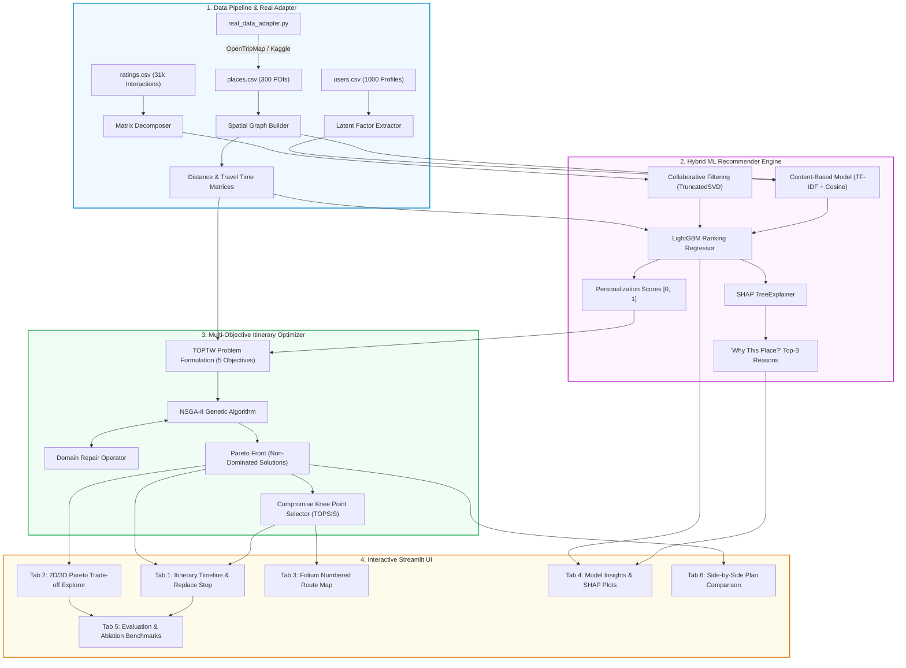

# System Architecture & Technical Specifications

## 1. High-Level System Architecture Diagram

---

## 2. Component Breakdown

| Module | Core Responsibility | Key Technologies |
| :--- | :--- | :--- |
| `data/generate_data.py` | Generates realistic synthetic South India tourism places, user profiles, and ratings | `pandas`, `numpy`, Haversine formula |
| `data/real_data_adapter.py` | Extensible adapter interface for Kaggle CSVs, OpenTripMap REST APIs | `abc.ABC`, Schema Validator |
| `src/utils/geo.py` | Computes spherical Haversine distances and caches driving time matrices | `numpy`, Vectorized distance |
| `src/recommender/content.py` | Extracts tag TF-IDF and computes cosine similarity with user preference vectors | `scikit-learn` `TfidfVectorizer` |
| `src/recommender/collaborative.py` | Performs SVD matrix factorization with mean-centering and folding-in | `scikit-learn` `TruncatedSVD` |
| `src/recommender/hybrid.py` | Fuses CB, CF, distance, budget match, and season via LightGBM regression | `lightgbm.LGBMRegressor` |
| `src/recommender/explain.py` | Computes TreeSHAP attributions and generates top-3 narrative explanations | `shap.TreeExplainer`, `plotly` |
| `src/optimizer/problem.py` | Encodes TOPTW with 5 objectives, time windows, and pace limits | `pymoo.core.problem.Problem` |
| `src/optimizer/repair.py` | Constraint-repair operator preventing budget violations and route scatter | `pymoo.core.repair.Repair` |
| `src/optimizer/solve.py` | Executes NSGA-II / NSGA-III and filters non-dominated fronts | `pymoo` `minimize`, `NonDominatedSorting` |
| `src/optimizer/selection.py` | Finds knee point using nearest-to-ideal compromise programming | Normalized Euclidean distance |
| `src/optimizer/baselines.py` | Implements Random, Greedy Score, Greedy Score/Cost, and Weighted-Sum GA | Heuristics & Single-objective GA |
| `src/evaluation/rec_metrics.py` | Computes RMSE, MAE, Precision@K, Recall@K, and NDCG@K | Custom vectorized metrics |
| `src/evaluation/opt_metrics.py` | Computes Hypervolume, Spacing, and Constraint Violation rates | `pymoo.indicators.hv.HV` |
| `app/streamlit_app.py` | Interactive dashboard featuring 6 tabs, timeline, 3D Plotly, and Folium | `streamlit`, `streamlit-folium`, `plotly` |

---

## 3. Data Flow Execution Sequence
1. **Request Ingestion:** The user specifies start hub (e.g., Bengaluru), trip duration (e.g., 3 days), budget (e.g., ₹12,000), pace (moderate), and category interest sliders.
2. **Personalization Scoring:** The Hybrid Recommender scores all 300 places in under 50 ms. Top candidate places within accessible geographic radius are passed to the optimizer.
3. **Multi-Objective Search:** NSGA-II explores the 5-dimensional trade-off space over 30 generations (completing in ~1.7 seconds).
4. **Pareto Front Extraction:** Exact non-dominated solutions are identified (averaging ~31 distinct plans).
5. **Knee Point Selection:** The compromise knee point is calculated and rendered as default; user preference sliders allow zero-latency interactive plan selection directly on the front.
6. **Exploration & Customization:** The user reviews day-by-day itineraries, clicks "Replace this place" if desired, inspects SHAP explanations, reviews route polylines on Folium, and exports to CSV/Markdown.

